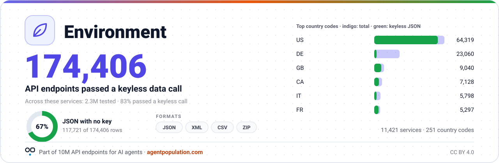
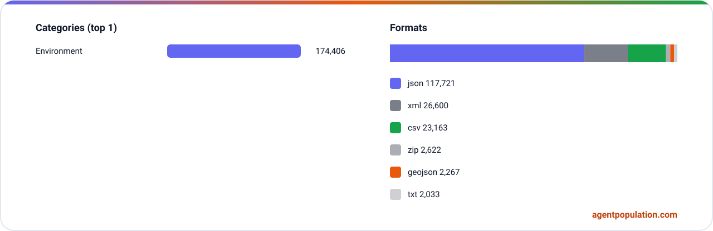

<p align="center"></p>

# 🌿 Environment API endpoints

**174,406 environment API endpoints that answered a keyless GET with a data body. For agent and app builders.**

<p align="center"><a href="#files"></a> <a href="#columns-and-tags"></a> <a href="#whats-inside"></a> <a href="#whats-inside"></a> <a href="LICENSE"></a></p>

<p align="center"><a href="#whats-in-it-for-you">What's in it</a> · <a href="#for-ai-agents">For AI agents</a> · <a href="#quick-start">Quick start</a> · <a href="#test-it-yourself">Test it yourself</a> · <a href="#files">Files</a> · <a href="#licence-and-credit">Licence</a> · <a href="#part-of-10m-api-endpoints-for-ai-agents">More packs</a></p>

This repository holds a 1,000-row sample and the services list; the full list of 174,406 endpoints is one download from the [latest release](https://github.com/agentpopulation/170k-environment-apis-for-agents/releases/latest).

**Endpoints for building a pollution, nature or land tracker.** Species occurrence records by country, air-quality readings, gamma dose-rate and radioactivity measurements, emissions and land statistics by country, waste, soil, forest, noise and protected-area map layers, as URLs that answered with no key on their test date. A large share of the rows sit in the Environment category with no environmental term in the title (statistics tables, plans, street layers); the starting points skip them, and Known limits counts them.

Selection rule: rows where `category is "Environment"`, less the rows that a leave-out rule drops (each counted under Known limits).

71,540 of these 174,406 rows match the focus rule (below); the others are in the pack by the selection rule only, and Known limits says what they are. 47,818 rows (27.4%) are map layers on ArcGIS Online, where anyone can publish.

## In plain words

**What is an API endpoint?** An API endpoint is one web address that a program can ask for data, for example the latest reading at one weather station. A single service, such as a national weather agency, can have thousands of endpoints: one per station, city or dataset. This pack counts endpoints, not separate services.

**What does "passed a data call" mean?** On the date shown in each row, AgentPopulation sent one plain request to that address, with no password or key, and got a non-empty data body back (JSON, CSV, XML or a file): not an error page and not an empty result. Some bodies describe a dataset rather than hold its values; see Known limits. It shows the address answered with data on that day. It is not a promise that it answers today, and licences and usage limits were not reviewed.

## What's in it for you

Four ways to use this pack. Each bucket gives a count, a filter you can apply to the CSV, one example that passed, and a list of recommended starting points with the rule that picked them. Buckets overlap; a row can fit more than one.

Examples, recommended lists and the preview are drawn from rows that match this pack's focus rule, so a row that the selection rule put in this pack but that is about something else is not shown as a starting point. Counts cover the whole bucket.

<details>
<summary>The focus rule</summary>

Focus rule: `title matches /environment|umwelt|environnement|ambiental|ambientale|milieu|περιβαλλ|pollut|emission|greenhouse|\bghg\b|\bco2\b|co₂|carbon|klima|climat|air quality|\bair\b|luftqualit|particulate|pm ?2[._ ]?5|pm ?10\b|ozon|nitrogen dioxide|\bno2\b|noise|lärm|laerm|bruit|rumore|radioactiv|radioaktiv|gamma-odl|dose rate|radon|biodivers|species|habitat|biotop|wildlife|fauna|flora|occurrence|gbif|\bbirds?\b|\bbats?\b|amphibian|reptile|insect|pollinat|invasive|mammal|\bforests?\b|forestry|waldgebiet|forêt|woodland|\btrees?\b|tree canopy|canopy|baum|bäume|arbres?|protected area|protected landscape|nature reserve|nature conservation|naturschutz|natura 2000|ramsar|znieff|conservation|national park|nationalpark|wetland|mangrove|peatland|\bmoor|grassland|\bheath(land)?\b|vegetation|land cover|green space|green area|soil|boden|erosion|contaminat|altlast|brownfield|waste|abfall|déchet|rifiut|residuos|recycl|landfill|compost|\blitter|water quality|bathing water|wastewater|sewage|ecolog|ökolog|ecosystem|landscape|conserved|wdpca|\bnature\b|natural area|macroinvertebrat|hornet|frelon|airshed|geluid/i AND NOT title matches /\bb-?plan\b|bebauungsplan|xplanung|development plan|land use plan|flächennutzungsplan|amendment|(^|[\s(-])änderung|bodenrichtwert|soil benchmark|land value|monument|architectural|historic|heritage|denkmal/i AND NOT title matches /employ|unemploy|beneficiar|contribution rate|workers|pension|passive policies|self-employed/i`

</details>

### 🤖 Agent tools: Species records, waste and pollution data an agent can call

**34,035** endpoints from 5,055 services · Wrap one URL pattern as a get_species_records tool: pass a country code and a group, return species names, dates and coordinates; page with offset for more.

3,557 of these are GBIF occurrence searches for one country and one group or filter (such as animals, plants, birds, endangered species or museum specimens), 20 records per call.

Start with: `tags has agent-ready AND NOT tags has air-quality AND title matches /biodivers|species|habitat|biotop|wildlife|fauna|flora|gbif|\bbirds?\b|\bbats?\b|amphibian|reptile|insect|pollinat|invasive|neophyt|\btrees?\b|tree canopy|\bforests?\b|forestry|woodland|protected area|conserved area|wdpca|nature reserve|naturschutz|natura 2000|ramsar|znieff|national park|wetland|mangrove|grassland|vegetation|land cover|green space|radioactiv|radioaktiv|gamma-odl|dose rate|radon|pollut|emission|greenhouse|\bghg\b|\bco2\b|noise|lärm|bruit|waste|abfall|déchet|rifiut|recycl|landfill|contaminat|altlast|heavy metal|soil|boden|erosion/i AND NOT subcategory matches /PxWeb|PxWin|StatCan|JSON-stat|StatLine/i AND NOT title matches /employ|unemploy|beneficiar|contribution rate|workers|pension|passive policies|self-employed|monument|architectural|historic|heritage|denkmal|bodenrichtwert|soil benchmark|land value/i AND NOT host in (erddap.sensors.ioos.us, api.scb.se, pxweb.stat.si, data.ssb.no, andmed.stat.ee, openstat.psa.gov.ph) AND NOT url matches /request=getcapabilities|/erddap/info//i`

Example: [GBIF biodiversity records - museum specimens: And…](https://api.gbif.org/v1/occurrence/search?country=AD&basisOfRecord=PRESERVED_SPECIMEN&limit=20) · GBIF (Global Biodiversity Information Facility) · passed 2026-11-14

<details>
<summary>Recommended starting points: 8 services, picked by the stated criteria inside</summary>

**Recommended starting points.** Selected by stated criteria, not a ranking of quality: Services in this pack with the most endpoints that match this bucket and are tagged `agent-ready` (no key sent in the test call, JSON body, passed a data call). Ties go to the service with more country codes, then by name. Only services with at least one bucket row that matches the focus rule are listed, and the sample comes from those rows; the counts cover the whole bucket. The sample URL is the first row by URL sort after preferring, in this order: rows that match the bucket's sample preference when it has one, rows that return values rather than describe a dataset or a service (not ERDDAP /info/ pages, OGC GetCapabilities requests, bare OWS addresses, PxWeb tables, UN SDG series lists, Statistics Canada download pointers, WorldPop listings, GTFS validation reports, untitled rows or service root addresses), and agent-ready rows. Sample preference in this bucket: `url contains "api.gbif.org/v1/occurrence/search"`. Services named "ArcGIS organization" hold map layers from many owners and are added only when fewer than 5 other services match.

| Service (host) | Endpoints in bucket | In pack | Country codes in bucket | Formats in bucket | Sample URL that passed |
|---|---:|---:|---|---|---|
| GBIF (Global Biodiversity Information Facility) (api.gbif.org) | 3,557 | 3,557 | 190 codes | json | [GBIF biodiversity records - museum spec…](https://api.gbif.org/v1/occurrence/search?country=AD&basisOfRecord=PRESERVED_SPECIMEN&limit=20) (2026-11-14) |
| Observation (observation.org) | 1,000 | 1,000 | NL | json | [Observation.org (Stichting Observation …](https://observation.org/api/v1/species/100944/) (2026-11-15) |
| Tela Botanica (api.tela-botanica.org) | 1,000 | 1,000 | FR | json | [Tela Botanica eFlore (BDTFX French flor…](https://api.tela-botanica.org/service:eflore:0.1/bdtfx/taxons/1014) (2026-11-15) |
| api.plutof.ut.ee | 1,000 | 1,000 | EE | json | [PlutoF (University of Tartu biodiversit…](https://api.plutof.ut.ee/v1/public/taxa/?search_query=Abatus) (2026-11-15) |
| OBIS (Ocean Biodiversity Information System) (api.obis.org) | 1,000 | 1,000 | global or unknown | json | [OBIS (Ocean Biodiversity Information Sy…](https://api.obis.org/v3/dataset/002eea41-acbf-4d60-ad84-6f4e3c46d9be) (2026-11-15) |
| Biodiversitydata (api.biodiversitydata.nl) | 999 | 999 | NL | json | [Naturalis Biodiversity Center (Netherla…](https://api.biodiversitydata.nl/v2/geo/query?_size=10) (2026-11-15) |
| Usanpn (services.usanpn.org) | 994 | 998 | US | json | [USA National Phenology Network: USA-NPN…](https://services.usanpn.org/npn_portal/phenophases/getPhenophasesForSpecies.json?species_id=1) (2026-11-15) |
| Globalforestwatch (data-api.globalforestwatch.org) | 987 | 987 | US | json | [Global Forest Watch Data API (World Res…](https://data-api.globalforestwatch.org/dataset/aqueduct_crop_baseline_2020) (2026-11-15) |

</details>

### 📱 App features: Nature, soil, noise and waste map layers

**5,880** endpoints from 2,067 services · Draw protected areas, habitats, tree cover, noise zones, contaminated sites or waste points as a map layer, and show the nearest one on a card.

Start with: `(format is geojson OR subcategory contains "ArcGIS feature layer" OR url matches /request=getfeature/i) AND title matches /biodivers|species|habitat|biotop|wildlife|fauna|flora|gbif|\bbirds?\b|\bbats?\b|amphibian|reptile|insect|pollinat|invasive|neophyt|\btrees?\b|tree canopy|\bforests?\b|forestry|woodland|protected area|conserved area|wdpca|nature reserve|naturschutz|natura 2000|ramsar|znieff|national park|wetland|mangrove|grassland|vegetation|land cover|green space|radioactiv|radioaktiv|gamma-odl|dose rate|radon|pollut|emission|greenhouse|\bghg\b|\bco2\b|noise|lärm|bruit|waste|abfall|déchet|rifiut|recycl|landfill|contaminat|altlast|heavy metal|soil|boden|erosion/i AND NOT tags has air-quality AND NOT title matches /\bb-?plan\b|bebauungsplan|xplanung|development plan|land use plan|flächennutzungsplan|amendment|(^|[\s(-])änderung|monument|architectural|historic|heritage|denkmal|bodenrichtwert|soil benchmark|land value/i AND NOT host is www.imis.bfs.de`

Example: [Protected and Conserved Areas (WDPCA) in Albania …](https://hub.arcgis.com/api/download/v1/items/8664a0d82205448e942c1189775846be/geojson?layers=0&where=ISO3+%3D+%27ALB%27&redirect=true&spatialRefId=4326) · ArcGIS Online: HDX · passed 2026-11-15

<details>
<summary>Recommended starting points: 8 services, picked by the stated criteria inside</summary>

**Recommended starting points.** Selected by stated criteria, not a ranking of quality: Services in this pack with the most endpoints that match this bucket and passed a data call. Ties go to the service with more country codes, then by name. Only services with at least one bucket row that matches the focus rule are listed, and the sample comes from those rows; the counts cover the whole bucket. The sample URL is the first row by URL sort after preferring, in this order: rows that match the bucket's sample preference when it has one, rows that return values rather than describe a dataset or a service (not ERDDAP /info/ pages, OGC GetCapabilities requests, bare OWS addresses, PxWeb tables, UN SDG series lists, Statistics Canada download pointers, WorldPop listings, GTFS validation reports, untitled rows or service root addresses), and agent-ready rows. Sample preference in this bucket: `NOT url matches /request=getcapabilities/i`. Services named "ArcGIS organization" hold map layers from many owners and are added only when fewer than 5 other services match.

| Service (host) | Endpoints in bucket | In pack | Country codes in bucket | Formats in bucket | Sample URL that passed |
|---|---:|---:|---|---|---|
| ArcGIS Online: HDX (hub.arcgis.com) | 185 | 590 | global or unknown | geojson | [Protected and Conserved Areas (WDPCA) i…](https://hub.arcgis.com/api/download/v1/items/8664a0d82205448e942c1189775846be/geojson?layers=0&where=ISO3+%3D+%27ALB%27&redirect=true&spatialRefId=4326) (2026-11-15) |
| Santee Cooper GIS Laboratory - College of Charleston (ArcGIS Online) (services1.arcgis.com) | 64 | 131 | US | json | [Florida Conifer Habitat](https://services1.arcgis.com/5Gtv38l8677OspKm/arcgis/rest/services/Florida_Conifer_Habitat/FeatureServer/0/query?where=1%3D1&outFields=*&returnGeometry=false&resultRecordCount=5&f=json) (2026-11-14) |
| Sazp (geos.sazp.sk) | 62 | 474 | SK | xml | [Moisture regime of soils \[Atlas of the …](https://geos.sazp.sk/geoserver/atlas_krajiny_sr/C04081_01/wfs?SERVICE=WFS&REQUEST=GetFeature&VERSION=2.0.0&TYPENAMES=atlas_krajiny_sr%3AC04081_01&COUNT=1) (2026-11-14) |
| Clemson University (ArcGIS Online) (services1.arcgis.com) | 60 | 127 | US | json | [CO2EmissionbyZD](https://services1.arcgis.com/x5wCko8UnSi4h0CB/arcgis/rest/services/CO2EmissionbyZD/FeatureServer/0/query?where=1%3D1&outFields=*&returnGeometry=false&resultRecordCount=5&f=json) (2026-11-14) |
| DOV Flanders subsoil / water (www.dov.vlaanderen.be) | 60 | 220 | BE | xml | [INSPIRE harmonized - Soil locations](https://www.dov.vlaanderen.be/geoserver-inspire/observedsoilprofile/wfs?SERVICE=WFS&version=2.0.0&request=GetFeature&count=1&typeName=ObservedSoilProfile) (2026-11-14) |
| Atmo Normandie (ArcGIS Online) (services7.arcgis.com) | 48 | 57 | FR | json | [Emissions\_de\_COVNM\_du\_secteur\_agricultu…](https://services7.arcgis.com/FPRT1cIkPKcq73uN/arcgis/rest/services/Emissions_de_COVNM_du_secteur_agriculture_en_kg_en_2023/FeatureServer/0/query?where=1%3D1&outFields=*&returnGeometry=false&resultRecordCount=5&f=json) (2026-11-14) |
| Esri UK (ArcGIS Online) (services.arcgis.com) | 43 | 45 | GB | json | [Barking\_and\_Dagenham\_Env\_Emissions](https://services.arcgis.com/qHLhLQrcvEnxjtPr/arcgis/rest/services/Barking_and_Dagenham_Env_Emissions/FeatureServer/0/query?where=1%3D1&outFields=*&returnGeometry=false&resultRecordCount=5&f=json) (2026-11-14) |
| University of Illinois (ArcGIS Online) (services.arcgis.com) | 42 | 106 | CN, US | json | [Bradbury 2018 CO2 Emissions](https://services.arcgis.com/GL0fWlNkwysZaKeV/arcgis/rest/services/Bradbury_2018_CO2_Emissions/FeatureServer/0/query?where=1%3D1&outFields=*&returnGeometry=false&resultRecordCount=5&f=json) (2026-11-14) |

</details>

### 🧠 Grounding and data pipelines: Emissions, waste, forest and radiation series for scheduled loads

**13,026** endpoints from 443 services · Load emissions, waste, forest and radiation series on a schedule into your own store, so answers about the environment cite a dated source.

892 of these are Our World in Data chart CSVs with a country in the URL; some return that country year by year, others the latest year for each country.

Start with: `(format in (csv, xml, zip, txt) OR subcategory contains "JSON-stat" OR subcategory contains "OWID") AND title matches /biodivers|species|habitat|biotop|wildlife|fauna|flora|gbif|\bbirds?\b|\bbats?\b|amphibian|reptile|insect|pollinat|invasive|neophyt|\btrees?\b|tree canopy|\bforests?\b|forestry|woodland|protected area|conserved area|wdpca|nature reserve|naturschutz|natura 2000|ramsar|znieff|national park|wetland|mangrove|grassland|vegetation|land cover|green space|radioactiv|radioaktiv|gamma-odl|dose rate|radon|pollut|emission|greenhouse|\bghg\b|\bco2\b|noise|lärm|bruit|waste|abfall|déchet|rifiut|recycl|landfill|contaminat|altlast|heavy metal|soil|boden|erosion|carbon|climat/i AND NOT title matches /employ|unemploy|beneficiar|contribution rate|workers|pension|passive policies|self-employed/i AND NOT title matches /\bb-?plan\b|bebauungsplan|xplanung|development plan|land use plan|flächennutzungsplan|amendment|(^|[\s(-])änderung|bodenrichtwert|soil benchmark|land value/i AND NOT url matches /request=getcapabilities/i`

Example: [Radioactivity measurements in: Cocoa powder solub…](https://daten.transparenz.hamburg.de/Dataport.HmbTG.ZS.Webservice.GetRessource100/GetRessource100.svc/00001601-9b8d-4655-99be-83a5c58e27f6/Kakaopulver_loeslich.csv) · daten.transparenz.hamburg.de · passed 2026-11-14

<details>
<summary>Recommended starting points: 8 services, picked by the stated criteria inside</summary>

**Recommended starting points.** Selected by stated criteria, not a ranking of quality: Services in this pack with the most endpoints that match this bucket and passed a data call. Ties go to the service with more country codes, then by name. Only services with at least one bucket row that matches the focus rule are listed, and the sample comes from those rows; the counts cover the whole bucket. The sample URL is the first row by URL sort after preferring, in this order: rows that match the bucket's sample preference when it has one, rows that return values rather than describe a dataset or a service (not ERDDAP /info/ pages, OGC GetCapabilities requests, bare OWS addresses, PxWeb tables, UN SDG series lists, Statistics Canada download pointers, WorldPop listings, GTFS validation reports, untitled rows or service root addresses), and agent-ready rows. Sample preference in this bucket: `NOT url matches /request=getcapabilities/i AND title matches /emission|co2|waste|forest|radioactiv|gamma|soil|species/i`. Services named "ArcGIS organization" hold map layers from many owners and are added only when fewer than 5 other services match.

| Service (host) | Endpoints in bucket | In pack | Country codes in bucket | Formats in bucket | Sample URL that passed |
|---|---:|---:|---|---|---|
| daten.transparenz.hamburg.de | 3,826 | 3,826 | DE | csv | [Radioactivity measurements in: Cocoa po…](https://daten.transparenz.hamburg.de/Dataport.HmbTG.ZS.Webservice.GetRessource100/GetRessource100.svc/00001601-9b8d-4655-99be-83a5c58e27f6/Kakaopulver_loeslich.csv) (2026-11-14) |
| Our World in Data (ourworldindata.org) | 892 | 1,044 | 190 codes | csv | [Our World in Data: annual change forest…](https://ourworldindata.org/grapher/annual-change-forest-area.csv?v=1&csvType=filtered&useColumnShortNames=true&country=~ABW) (2026-11-14) |
| Usgs (data.usgs.gov) | 710 | 2,702 | US | xml | [Agricultural Waste Management Systems o…](https://data.usgs.gov/datacatalog/metadata/USGS.055e7955-ed10-46e4-ac0d-d1c2b62e4823.xml) (2026-11-15) |
| www.imis.bfs.de | 570 | 781 | DE | xml, csv | [Measurement data Gamma-ODL: Munich-Neuh…](https://www.imis.bfs.de/ogc/opendata/ows?service=WFS&version=1.1.0&request=GetFeature&typeName=opendata:odlinfo_timeseries_odl_1h&outputFormat=KML&viewparams=kenn:091620001) (2026-11-14) |
| Transparenzportal Hamburg (archiv.transparenz.hamburg.de) | 486 | 1,301 | DE | xml, zip | [Anlagen nach der Industrieemissions-Ric…](https://archiv.transparenz.hamburg.de/hmbtgarchive/HMDK/hh_wfs_ied_anlagen_213128_snap_3.XML) (2026-11-15) |
| data.gov.uk (assets.publishing.service.gov.uk) | 268 | 268 | GB | csv | [assets.publishing.service.gov.uk: Spend…](https://assets.publishing.service.gov.uk/government/uploads/system/uploads/attachment_data/file/1005737/2b.__FC_-_Over_25K_-_May_21_.csv) (2026-11-15) |
| ArcGIS Online: Vegetation (data-cdfw.opendata.arcgis.com) | 264 | 2,491 | US | xml, csv | [Aspen Delineation - Plumas National For…](https://data-cdfw.opendata.arcgis.com/api/download/v1/items/0008fe7bbcdf48e0bca09cae5eb3870f/csv?layers=0) (2026-11-15) |
| Canada (open.canada.ca) | 253 | 814 | CA | csv, txt | [Forest vegetation community areal exten…](https://open.canada.ca/data/dataset/072803b9-0374-44b0-b602-36fb19c52e1c/resource/28341dca-d053-4aef-b624-aa3253fd3879/download/elk_island_np_forest_vegetation_community_1984-2015_data_dictionary.csv) (2026-11-15) |

</details>

### 🧪 Evals and testing: Species searches, readings, map layers and files to test an environment tool

**174,406** endpoints · 11,421 services · 251 country codes · 6 formats · Run your environment tool against a fixed set of URLs across formats; check that species, pollutant, value, unit and date parse, and keep last_tested as the baseline for your own re-tests.

Start with: the whole pack

Example: [GBIF biodiversity records - museum specimens: And…](https://api.gbif.org/v1/occurrence/search?country=AD&basisOfRecord=PRESERVED_SPECIMEN&limit=20) · GBIF (Global Biodiversity Information Facility) · passed 2026-11-14

<details>
<summary>Recommended starting points: 8 services, picked by the stated criteria inside</summary>

**Recommended starting points.** Selected by stated criteria, not a ranking of quality: Services in this pack that returned the most different formats, then the most endpoints that passed a data call, then by name: a mix of response shapes to test parsers and tool calls. Only services with at least one bucket row that matches the focus rule are listed, and the sample comes from those rows; the counts cover the whole bucket. The sample URL is the first row by URL sort after preferring, in this order: rows that match the bucket's sample preference when it has one, rows that return values rather than describe a dataset or a service (not ERDDAP /info/ pages, OGC GetCapabilities requests, bare OWS addresses, PxWeb tables, UN SDG series lists, Statistics Canada download pointers, WorldPop listings, GTFS validation reports, untitled rows or service root addresses), and agent-ready rows. Services named "ArcGIS organization" hold map layers from many owners and are added only when fewer than 5 other services match.

| Service (host) | Endpoints in bucket | In pack | Country codes in bucket | Formats in bucket | Sample URL that passed |
|---|---:|---:|---|---|---|
| Slovensko (data.slovensko.sk) | 437 | 437 | SK | csv, zip, xml, json, geojson, txt | [Fee for municipal waste](https://data.slovensko.sk/download?id=4d04c2de-93fd-46eb-b10d-9b21e558c97f) (2026-11-14) |
| Public (download.data.public.lu) | 534 | 534 | LU | json, xml, geojson, csv, zip | [Administration de l'environnement: Air …](https://download.data.public.lu/resources/air-quality-geostatistical-interpolation/20261113-220157/lux-data-no2-1hour.json) (2026-11-15) |
| Canadian Urban Data Catalogue (CUDC) (www.donneesquebec.ca) | 533 | 533 | CA | csv, json, xml, geojson, txt | [CDU woods and forest corridors of inter…](https://www.donneesquebec.ca/recherche/dataset/06950d7f-94d9-4033-90b2-f0a3f57eabbf/resource/55b380aa-5df9-48ec-9e61-ed5ff5ac667b/download/cdu-bois-et-corridors-forestiers-interet.geojson) (2026-11-15) |
| Open Development Mekong Datahub (data.opendevelopmentmekong.net) | 280 | 280 | KH, LA, MM | json, xml, csv, geojson, txt | [Agro-Ecological Regions of Myanmar - MM…](https://data.opendevelopmentmekong.net/api/3/action/datastore_search?resource_id=0441336b-63ee-425c-90e3-5cc62ded46af&limit=1) (2026-11-15) |
| Canadian Urban Data Catalogue (CUDC) (geohub.saskatchewan.ca) | 194 | 194 | CA | json, csv, xml, zip, geojson | [Wildlife Habitat Protection Act - GeoJS…](https://geohub.saskatchewan.ca/api/download/v1/items/1ffa27744fd04ee6986de4bee7ad4052/geojson?layers=0) (2026-11-15) |
| Open Development Cambodia Datahub (data.opendevelopmentcambodia.net) | 171 | 171 | KH | json, xml, geojson, zip, csv | [Agro-Ecological Regions of Myanmar - MM…](https://data.opendevelopmentcambodia.net/api/3/action/datastore_search?resource_id=0441336b-63ee-425c-90e3-5cc62ded46af&limit=1) (2026-11-15) |
| ArcGIS Online: ACT Canopy Cover 2020 1m WESTON (actmapi-actgov.opendata.arcgis.com) | 150 | 150 | AU | csv, zip, json, geojson, xml | [ACTGOV Mature Tree 2020 Crowns - CSV](https://actmapi-actgov.opendata.arcgis.com/api/download/v1/items/267b771369fb43c682b1261f742cc95c/csv?layers=0) (2026-11-15) |
| ArcGIS Online: Helsingin Seudun Liikenteen (HSL) kaupunkipyöräasemat (opendata.arcgis.com) | 143 | 143 | 5 codes | xml, csv, json, geojson, zip | [Sheffield Local Wildlife Sites](https://opendata.arcgis.com/datasets/07c7d3a8031b401d80feb16512a659d5_13.geojson) (2026-11-14) |

</details>

The same lists are in [recommended.json](recommended.json), ready for an agent to load.

## Questions an agent can answer with this pack

- Which animal species have GBIF occurrence records in a given country? Try [GBIF biodiversity records - animals: Andorra](https://api.gbif.org/v1/occurrence/search?country=AD&kingdomKey=1&limit=20) (GBIF (Global Biodiversity Information Facility), passed 2026-11-14).
- What daily gamma dose rate, in µSv/h, does a German monitoring station report? Try [www.imis.bfs.de: Measurement data Gamma-ODL: Ettr…](https://www.imis.bfs.de/ogc/opendata/ows?service=WFS&version=1.1.0&request=GetFeature&typeName=opendata%3Aodlinfo_timeseries_odl_24h&outputFormat=json&viewparams=kenn%3A097781372) (www.imis.bfs.de, passed 2026-11-14).
- How have CO2 emissions per person changed in a given country? Try [Our World in Data: CO2 emissions per capita - Aru…](https://ourworldindata.org/grapher/co-emissions-per-capita.csv?v=1&csvType=filtered&useColumnShortNames=true&country=~ABW) (Our World in Data, passed 2026-11-14).
- What share of a country's land is forest? Try [Our World in Data: forest area as share of land a…](https://ourworldindata.org/grapher/forest-area-as-share-of-land-area.csv?v=1&csvType=filtered&useColumnShortNames=true&country=~ABW) (Our World in Data, passed 2026-11-14).

## What "passed a data call" means

> [!NOTE]
> On the date in `last_tested` (IST), one GET to the URL, sent with no key, returned HTTP 2xx and a non-empty data body. HTML pages and empty results did not pass. The `format` column records what came back. This is a test result for that date, not a promise that the URL answers today. Licences, terms, rate limits, accuracy and freshness were not reviewed. Endpoints are URLs, not separate APIs; many share one service. This pack was tested 14–15 Nov 2026; snapshot 15 Nov 2026.

## For AI agents

Start from keyless JSON endpoints (`agent-ready`). The code below loads `recommended.json` and calls the first recommended service in the Agent tools bucket, with a timeout (`node examples/agent-start.mjs --recommended`). With no argument, `node examples/agent-start.mjs` calls the most recently tested agent-ready row of the sample; pass a `.csv` or `.csv.gz` path to use that file instead. See [examples/agent-start.mjs](examples/agent-start.mjs).

```js
// Node 18+. Loads recommended.json (the local copy, or the raw file on GitHub) and calls one keyless JSON endpoint.
import fs from 'node:fs';

const RAW = 'https://raw.githubusercontent.com/agentpopulation/170k-environment-apis-for-agents/main/recommended.json';
const rec = fs.existsSync('recommended.json')
  ? JSON.parse(fs.readFileSync('recommended.json', 'utf8'))
  : await (await fetch(RAW)).json();

const pick = rec.buckets.find((b) => b.id === 'agent').services[0];
try {
  const res = await fetch(pick.sample_url, {
    headers: { 'User-Agent': 'agent-example/1.0' },
    signal: AbortSignal.timeout(15000),
  });
  console.log(pick.service, res.status, res.headers.get('content-type'));
  console.log((await res.text()).slice(0, 300));
} catch (err) {
  console.log(`did not answer now; last passed ${pick.sample_last_tested} (${err.message})`);
}
```

How an agent picks an endpoint:

1. Filter to `agent-ready` and your country or topic.
2. Prefer the newest `last_tested` and the larger services.
3. Call with a timeout and check the body before you use it.

## Quick start

The examples run against the sample in `data/` out of the box (1,000 rows). Each takes an optional path to a `.csv` or `.csv.gz` file instead.

```bash
git clone https://github.com/agentpopulation/170k-environment-apis-for-agents.git
cd 170k-environment-apis-for-agents
python examples/quickstart.py
node examples/quickstart.mjs
node examples/agent-start.mjs
```

Full list: download `Environment_API_Endpoints_AgentPopulation_Snapshot_2026-11-15.csv.gz` (174,406 rows, 8.2 MB) from [releases/latest](https://github.com/agentpopulation/170k-environment-apis-for-agents/releases/latest), then gunzip it and pass its path. The scripts also read the `.csv.gz` as it is.

```bash
gunzip Environment_API_Endpoints_AgentPopulation_Snapshot_2026-11-15.csv.gz
python examples/quickstart.py Environment_API_Endpoints_AgentPopulation_Snapshot_2026-11-15.csv
node examples/quickstart.mjs Environment_API_Endpoints_AgentPopulation_Snapshot_2026-11-15.csv
```

### curl

Quote the URL: some contain commas.

```bash
curl -sL "https://raw.githubusercontent.com/agentpopulation/170k-environment-apis-for-agents/main/data/Environment_API_Endpoints_AgentPopulation_Sample.csv" | head -n 4
curl -s --max-time 15 "https://api.gbif.org/v1/occurrence/search?country=AD&basisOfRecord=PRESERVED_SPECIMEN&limit=20" | head -c 600
```

### Python

Standard library only: [examples/quickstart.py](examples/quickstart.py) reads the sample, or the path you pass, keeps agent-ready rows and calls the most recently tested one.

<details>
<summary>The code</summary>

```python
# Python 3, standard library only. Run from a clone of this repository:
#   python examples/quickstart.py [path]
# With no path it reads the sample in data/. Pass the full list from the latest release (.csv or .csv.gz) instead.
# Keeps agent-ready rows and calls the most recently tested one.
import csv
import gzip
import os
import re
import sys
import urllib.request

HERE = os.path.dirname(os.path.abspath(__file__))
path = sys.argv[1] if len(sys.argv) > 1 else os.path.join(HERE, "..", "data", "Environment_API_Endpoints_AgentPopulation_Sample.csv")
opener = gzip.open if path.endswith(".gz") else open
with opener(path, "rt", newline="", encoding="utf-8") as f:
    rows = list(csv.DictReader(f))

agent = [r for r in rows if "agent-ready" in r["tags"].split("|")]
# Newest test date first; URLs that describe a dataset or a service rather than return values go last.
DESCRIBES = re.compile(r"/erddap/info/|action-report\.json$|[?&]request=getcapabilities|/GeoArea/[^/?]+/List|getFullTableDownloadCSV|hub\.worldpop\.org", re.I)
agent.sort(key=lambda r: r["last_tested"], reverse=True)
agent.sort(key=lambda r: 1 if DESCRIBES.search(r["url"]) else 0)
print(len(rows), "rows,", len(agent), "agent-ready")
if not agent:
    sys.exit(0)

row = agent[0]
req = urllib.request.Request(row["url"], headers={"User-Agent": "agent-example/1.0"})
try:
    with urllib.request.urlopen(req, timeout=15) as res:
        body = res.read(1_000_000).decode("utf-8", "replace")
        print(res.status, res.headers.get("Content-Type"))
        print(body[:300])
except Exception as err:
    print(f"did not answer now; last passed {row['last_tested']} ({err})")
```

</details>

### JavaScript

Reads the sample as JSON because the CSV has quoted commas.

<details>
<summary>The code</summary>

```js
// Node 18+. Reads the sample as JSON (the CSV has quoted commas), local file first.
import fs from 'node:fs';

const FILE = 'data/Environment_API_Endpoints_AgentPopulation_Sample.json';
const rows = fs.existsSync(FILE)
  ? JSON.parse(fs.readFileSync(FILE, 'utf8'))
  : await (await fetch('https://raw.githubusercontent.com/agentpopulation/170k-environment-apis-for-agents/main/data/Environment_API_Endpoints_AgentPopulation_Sample.json')).json();

const row = rows.find((r) => r.tags.includes('agent-ready'));
const res = await fetch(row.url, { headers: { 'User-Agent': 'agent-example/1.0' }, signal: AbortSignal.timeout(15000) });
console.log(res.status, (await res.text()).slice(0, 300));
```

</details>

### Agent tools

[examples/agent-tools.json](examples/agent-tools.json) holds two tool definitions in the shape most tool-calling APIs accept (name, description, JSON Schema); rename `parameters` if yours uses another key. [examples/quickstart.mjs](examples/quickstart.mjs) implements them:

- `find_endpoints` searches the agent-ready rows of the list by words, country code (their format is json). When you load the tools of more than one pack, prefix the names (for example `environment_find_endpoints`) so they do not clash.
- `fetch_endpoint` calls one URL, **refuses any URL that is not in the list** and does not follow redirects. The allowlist is built from the CSV, so a URL injected into a prompt is refused.

The same two tools can sit behind an MCP server.

## Test it yourself

Re-test endpoints from the sample with the same rule: HTTP 2xx and a non-empty body that is not an HTML page. Node 18+, no packages.

```bash
node tools/test-endpoints.mjs
```

It tests the first 50 URLs and prints one line: tested, passed, did not pass. Options: a `.csv` or `.csv.gz` path (the full list from the release), `--limit 50`, `--timeout-ms 10000`, `--out results.csv`. The results file holds `url`, `status`, `passed`, `content_type`, `ms` and `checked_at`; a status of `timeout` or `error:<code>` means no HTTP answer came back. It is polite: GET only, no key sent, at most 4 requests in flight, one at a time per listed host, at least 1 second between requests to one listed host, and reading stops once 256 kB of a body is kept. Redirects are followed and may lead to another host. `results.csv` is in `.gitignore`.

## Preview

One row from each of the five largest services among rows that match the focus rule, services with rows that return values first.

| Title | Service | Country | Format | Tested | Link |
|---|---|---|---|---|---|
| Radioactivity measurements in: Cocoa powder soluble (09.12.… | daten.transparenz.hamburg.de | DE | csv | 2026-11-14 | [daten.transparenz.hamburg.de](https://daten.transparenz.hamburg.de/Dataport.HmbTG.ZS.Webservice.GetRessource100/GetRessource100.svc/00001601-9b8d-4655-99be-83a5c58e27f6/Kakaopulver_loeslich.csv) |
| GBIF biodiversity records - museum specimens: Andorra | GBIF (Global Biodiversity Information Facility) | AD | json | 2026-11-14 | [api.gbif.org](https://api.gbif.org/v1/occurrence/search?country=AD&basisOfRecord=PRESERVED_SPECIMEN&limit=20) |
| data.gov.ro: List of uncertified measurements (UTD) on air … | data.gov.ro | RO | xml | 2026-11-15 | [data.gov.ro](https://data.gov.ro/dataset/02be02cc-d560-4654-a163-bd5f6a5fb41a/resource/00949de1-66bf-416a-8743-248cf3922438/download/statia-ro0115a-valori-nevalidate-aferente-lunii-februarie-anul-2015.xml) |
| Open-Meteo air quality: Quito, Ecuador | Open-Meteo air quality API | EC | json | 2026-11-14 | [air-quality-api.open-meteo.com](https://air-quality-api.open-meteo.com/v1/air-quality?latitude=-0.23&longitude=-78.52&current=pm10,pm2_5,us_aqi) |
| UK-AIR (Defra) air quality: Bristol St Paul's-Nitrogen oxid… | Defra | GB | json | 2026-11-14 | [uk-air.defra.gov.uk](https://uk-air.defra.gov.uk/sos-ukair/api/v1/timeseries/100) |

Browse the 1,000-row sample: [Sample CSV](data/Environment_API_Endpoints_AgentPopulation_Sample.csv) · [Sample JSON](data/Environment_API_Endpoints_AgentPopulation_Sample.json).

## What's inside

<p align="center"></p>

<details>
<summary>Country codes: 251</summary>

| Code | Country | Endpoints | |
|---|---|---:|---|
| US | United States | 64,319 | `████████████████████` |
| DE | Germany | 23,060 | `███████▏` |
| GB | United Kingdom | 9,040 | `██▊` |
| CA | Canada | 7,128 | `██▎` |
| IT | Italy | 5,798 | `█▊` |
| FR | France | 5,297 | `█▋` |
| CH | Switzerland | 5,039 | `█▋` |
| IE | Ireland | 3,135 | `█` |
| NL | Netherlands | 2,689 | `▉` |
| AU | Australia | 2,448 | `▊` |
| | other 241 codes | 37,737 | |
| | global or unknown | 8,716 | `██▊` |

</details>

<details>
<summary>Categories: top 1</summary>

| Category | Endpoints | |
|---|---:|---|
| Environment | 174,406 | `████████████████████` |

</details>

Formats: json 117,721 · xml 26,600 · csv 23,163 · zip 2,622 · geojson 2,267 · txt 2,033

<details>
<summary>Largest services: top 25 of 11,421</summary>

| Service | Host | Endpoints | Keyless JSON | |
|---|---|---:|---:|---|
| daten.transparenz.hamburg.de | daten.transparenz.hamburg.de | 3,826 | 0 | `████████████████████` |
| Komm | geodienste.komm.one | 3,665 | 0 | `███████████████████▏` |
| GBIF (Global Biodiversity Information Facility) | api.gbif.org | 3,557 | 3,557 | `██████████████████▋` |
| Usgs | data.usgs.gov | 2,702 | 0 | `██████████████▏` |
| ArcGIS Online: Vegetation | data-cdfw.opendata.arcgis.com | 2,491 | 656 | `█████████████` |
| Statistics Norway PxWeb | data.ssb.no | 1,588 | 1,588 | `████████▎` |
| data.gov.ro | data.gov.ro | 1,524 | 0 | `████████` |
| Transparenzportal Hamburg | archiv.transparenz.hamburg.de | 1,301 | 23 | `██████▊` |
| Italia Dati municipal dashboards | cruscotto-italia.dati.gov.it | 1,290 | 900 | `██████▊` |
| Latvijas Atvērto datu portāls | data.gov.lv | 1,204 | 36 | `██████▎` |
| Unibe | gis.cde.unibe.ch | 1,141 | 1,141 | `██████` |
| vector.sitg.ge.ch | vector.sitg.ge.ch | 1,126 | 339 | `█████▉` |
| Our World in Data | ourworldindata.org | 1,044 | 0 | `█████▌` |
| Open-Meteo air quality API | air-quality-api.open-meteo.com | 1,043 | 1,043 | `█████▌` |
| Defra | uk-air.defra.gov.uk | 1,015 | 1,015 | `█████▎` |
| Ipni † | www.ipni.org | 1,000 | 1,000 | `█████▎` |
| Observation | observation.org | 1,000 | 1,000 | `█████▎` |
| Taicol † | api.taicol.tw | 1,000 | 1,000 | `█████▎` |
| Tela Botanica | api.tela-botanica.org | 1,000 | 1,000 | `█████▎` |
| api.plutof.ut.ee | api.plutof.ut.ee | 1,000 | 1,000 | `█████▎` |
| OBIS (Ocean Biodiversity Information System) | api.obis.org | 1,000 | 1,000 | `█████▎` |
| Safecast | tt.safecast.org | 999 | 999 | `█████▎` |
| Biodiversitydata | api.biodiversitydata.nl | 999 | 999 | `█████▎` |
| Eol † | eol.org | 999 | 999 | `█████▎` |
| Itis † | services.itis.gov | 999 | 999 | `█████▎` |

† No row of these services matches the focus rule: the selection rule put them in this pack, so they are not used as a starting point.

</details>

<details>
<summary>Rows per test date: 14–15 Nov 2026</summary>

| Date (IST) | Endpoints | |
|---|---:|---|
| 2026-11-15 | 114,427 | `████████████████████` |
| 2026-11-14 | 59,979 | `██████████▌` |

</details>

## Files

| File | Rows | Size | Use |
|---|---:|---:|---|
| [data/Environment_API_Services_AgentPopulation.csv](data/Environment_API_Services_AgentPopulation.csv) | 11,421 | 676.8 kB | One row per service with its endpoint count in this pack |
| [data/Environment_API_Endpoints_AgentPopulation_Sample.csv](data/Environment_API_Endpoints_AgentPopulation_Sample.csv) | 1,000 | 325.0 kB | The sample: focus-rule rows first, each service in proportion to its share; ArcGIS Online layers count as one service |
| [data/Environment_API_Endpoints_AgentPopulation_Sample.json](data/Environment_API_Endpoints_AgentPopulation_Sample.json) | 1,000 | 518.4 kB | The same rows as JSON, tags as an array |
| [Environment_API_Endpoints_AgentPopulation_Snapshot_2026-11-15.csv.gz](https://github.com/agentpopulation/170k-environment-apis-for-agents/releases/latest) | 174,406 | 8.2 MB | The full list, gzipped CSV: a download from the latest release, checked by `SHA256SUMS.txt` |
| [tools/test-endpoints.mjs](tools/test-endpoints.mjs) | | | Re-tests endpoints from the sample or the full list |

Sample size: 1,000 rows, which is 1,000 or one third of the pack rounded down, whichever is smaller. Rows that match the focus rule come first. Each service gets rows in proportion to its share of those rows, at least one for the largest services and at most 50% of the sample while other services have rows; ArcGIS Online layers count as one service, whatever their organisation. Within a service, agent-ready rows, rows that return values and the newest test dates come first, and rows are written in turn across services. Service root addresses are placed at the end of the sample.

Full list: download `Environment_API_Endpoints_AgentPopulation_Snapshot_2026-11-15.csv.gz` (174,406 rows, 8.2 MB) from [releases/latest](https://github.com/agentpopulation/170k-environment-apis-for-agents/releases/latest), then gunzip it and pass its path. The scripts also read the `.csv.gz` as it is.

Excel users: Data > From Text/CSV, UTF-8. Files are UTF-8 without a byte-order mark and comma-separated.

## Columns and tags

<details>
<summary>Columns, types and tags</summary>

| Column | Type | Example | Meaning |
|---|---|---|---|
| url | string | [https://daten.transparenz.hamburg.de/Da…](https://daten.transparenz.hamburg.de/Dataport.HmbTG.ZS.Webservice.GetRessource100/GetRessource100.svc/00001601-9b8d-4655-99be-83a5c58e27f6/Kakaopulver_loeslich.csv) | The address that was tested |
| title | string | Radioactivity measurements in: Cocoa po… | Station, dataset or feed name |
| service | string | daten.transparenz.hamburg.de | The service the endpoint belongs to; joins to the services file together with host |
| host | string | daten.transparenz.hamburg.de | Host name of the address |
| country | string | DE | ISO 3166-1 alpha-2 code, or EU; empty when global or unknown |
| category | string | Environment | Category of the endpoint |
| subcategory | string |  | Left empty from the 15 Nov 2026 snapshot; kept so the columns stay the same |
| format | string | csv | What the test call returned: json, csv, geojson, xml, gtfs, zip, txt and so on |
| tags | string | `environment\|no-key\|csv` | Tags separated by \| |
| last_tested | date | 2026-11-14 | Date of the test call, YYYY-MM-DD (IST) |

| Tag | Rows | Meaning |
|---|---:|---|
| environment | 174,406 | Topic tag |
| no-key | 174,406 | No key was sent in the test call |
| agent-ready | 117,721 | No key sent, JSON body, passed a data call on last_tested |
| json | 117,721 | Format of the body |
| maps | 89,815 | Topic tag |
| open-data | 36,302 | Topic tag |
| xml | 26,600 | Format of the body |
| csv | 23,163 | Format of the body |
| air-quality | 12,408 | Topic tag |
| statistics | 9,886 | Topic tag |
| government | 8,144 | Topic tag |
| oceans | 4,201 | Topic tag |
| geojson | 2,267 | Format of the body |
| weather | 2,001 | Topic tag |
| science | 1,551 | Topic tag |
| health | 1,294 | Topic tag |
| economy | 1,111 | Topic tag |
| energy | 989 | Topic tag |
| elevation | 394 | Topic tag |
| transit | 393 | Topic tag |
| finance | 354 | Topic tag |
| aviation | 323 | Topic tag |
| maritime | 318 | Topic tag |
| rivers | 230 | Topic tag |
| climate | 214 | Topic tag |
| floods | 196 | Topic tag |
| hazards | 150 | Topic tag |
| forecast | 66 | Topic tag |
| wildfire | 40 | Topic tag |
| geocoding | 39 | Topic tag |
| tides | 38 | Topic tag |
| earthquakes | 36 | Topic tag |
| groundwater | 19 | Topic tag |
| ai-ml | 18 | Topic tag |
| traffic | 11 | Topic tag |
| mcp-server | 2 | Topic tag |
| parking | 1 | Topic tag |

A machine-readable copy of this dictionary is in [datapackage.json](datapackage.json).

</details>

## Known limits

- 36.9% of rows carry country code US; 8,716 rows have no code (global or unknown).
- 5,567 rows come from PxWeb or Statistics Canada services. Some statistics endpoints return metadata or a pointer on GET; the table may need a second request or a POST.
- 506 rows are ERDDAP /info/ pages: they describe a dataset rather than return its values, so the series needs a second request.
- 64,129 rows are map-layer queries with resultRecordCount set: the tested call asked for a few records; change the query to get the full layer.
- 1,722 rows carry limit=1: the tested call asked for one record; raise the limit or page through.
- 336 rows are open-data portal dataset records, which may return a dataset record with links rather than the table itself.
- 4,655 rows are files (zip 2,622, txt 2,033) rather than bodies an agent reads directly.
- 1 row is a service root address (the host alone or an API or version path such as /v1, with no query), which may describe the service rather than return data; the sample, examples and recommended lists use other rows first.
- 47,818 rows are layers on ArcGIS Online, where anyone can publish: some are class projects, tests or copies. Check the owner and the fields before you rely on one.
- 101,658 rows are in the Environment category but have no environmental term in the title (statistics tables, municipal datasets, plans and general map layers). Check the title before you use one; they are not used as starting points.
- 4,234 rows are street, sidewalk and address map layers with no environmental term in the title.
- 7,337 rows are land-use or building plans and their amendments, planning documents rather than environmental data.
- 316 rows are land values (Bodenrichtwerte, in some titles translated as soil benchmarks), property prices rather than soil data.
- 1,290 rows are Italian municipal dashboard files (census, property values, cadastre, vehicles, tourism, weather and others), one file per municipality and subject.
- 688 rows are Italian social-insurance tables (farm employment, unemployment benefits and contributions), not environmental data.
- 12,408 rows also carry the air-quality tag; the Air quality pack holds them with their own starting points.
- 3,557 rows are GBIF occurrence searches for one country and one group or filter, 20 records per call; page with offset for more.
- 3,826 rows are Hamburg radioactivity measurements, one CSV per sample (surface water, sludge, milk, fish, vegetables, food and others) and date.
- 13,937 rows are OGC GetCapabilities requests: they list the layers of a map service rather than return features.
- 1,141 rows from New Zealand (.nz), Canadian (.ca), Australian (.au) or Irish (.ie) hosts carry another country code or none in this snapshot; filter by host when you need one country.
- Stations and feeds can go quiet after their test date; re-test a URL before you rely on it.
- Not in this pack: endpoints that need a key or a POST, and URLs that did not pass.
- Left out: 962 rows whose URL carried a credential-looking parameter or a login.
- Left out: 2 rows with an email-like address.
- Left out: 2,510 ArcGIS Survey123 layers (they can hold people's form answers).
- Left out: 24 layers marked editable in the title (they can hold entries that people added).
- Left out: 338 ArcGIS layers that keep a form's default service name (they can hold people's form answers).
- Left out: 2 rows that passed a data call only from a network location in India.
- Left out: 6 rows whose address or title held a token-like string, a private address or a similar string.
- Left out: 731 ArcGIS class or coursework layers (lab, assignment, exam, quiz, lesson, exercise, tutorial and final-project layers, copies of class layers, layers named for a person or a person's home, and layers whose name ends in a person's name or holds a student number).
- Left out: 93 ArcGIS layers that hold reports, comments, submissions or form responses sent in by the public.

## Licence and credit

> [!IMPORTANT]
> This list (URLs, titles, tags and test results) is © 2026 AgentPopulation, released under [CC BY 4.0](https://creativecommons.org/licenses/by/4.0/). Credit AgentPopulation and link agentpopulation.com. The data each endpoint returns belongs to its provider and stays under that provider's terms; this licence does not cover it.

Copy-ready credit:

`Environment API endpoints by AgentPopulation (https://agentpopulation.com), CC BY 4.0, snapshot 15 Nov 2026.`

GitHub's "Cite this repository" button reads [CITATION.cff](CITATION.cff).

<!-- agentpopulation:start -->
## Part of 10M API endpoints for AI agents

This pack is one of the 24 topic packs of [10m-open-apis-for-ai-agents](https://github.com/agentpopulation/10m-open-apis-for-ai-agents), the open collection by [AgentPopulation](https://agentpopulation.com). Target: 10 million+ open API endpoints that pass a keyless API call.

AgentPopulation has tested over 5 million API endpoints: 5,129,834 tested, 3,726,509 passed a data call (snapshot 15 Nov 2026). This is the environment pack: 174,406 endpoints from 11,421 services. Packs overlap, so an endpoint can appear in more than one.

For the latest tested endpoints, search [agentpopulation.com/apis](https://agentpopulation.com/apis). This pack is a snapshot from 15 Nov 2026.

Sibling packs that share the most URLs with this one: [2.5m-agent-ready-apis](https://github.com/agentpopulation/2.5m-agent-ready-apis) (117,721 shared) · [190k-weather-apis-for-agents](https://github.com/agentpopulation/190k-weather-apis-for-agents) (13,423 shared) · [20k-air-quality-apis-for-agents](https://github.com/agentpopulation/20k-air-quality-apis-for-agents) (12,408 shared) · [270k-water-apis-for-agents](https://github.com/agentpopulation/270k-water-apis-for-agents) (4,612 shared) · [86k-oceans-apis-for-agents](https://github.com/agentpopulation/86k-oceans-apis-for-agents) (4,201 shared) · [130k-finance-economy-apis-for-agents](https://github.com/agentpopulation/130k-finance-economy-apis-for-agents) (1,448 shared). The rest are listed in [10m-open-apis-for-ai-agents](https://github.com/agentpopulation/10m-open-apis-for-ai-agents).

Questions, pack requests, reports of endpoints that stopped answering and requests to remove a row go to [Discussions](https://github.com/agentpopulation/10m-open-apis-for-ai-agents/discussions), or to [@agentpopulation](https://x.com/agentpopulation) on X. The packs are a work in progress and corrections are welcome.

Spotted a wrong row or a dead URL? Tell us on X: [@agentpopulation](https://x.com/agentpopulation).

If this pack saved you time, a star helps others find it.

---

Compiled by [AgentPopulation](https://agentpopulation.com) with [AP Desk](https://github.com/agentpopulation/apdesk) · [10m-open-apis-for-ai-agents](https://github.com/agentpopulation/10m-open-apis-for-ai-agents)

<!-- agentpopulation:end -->
